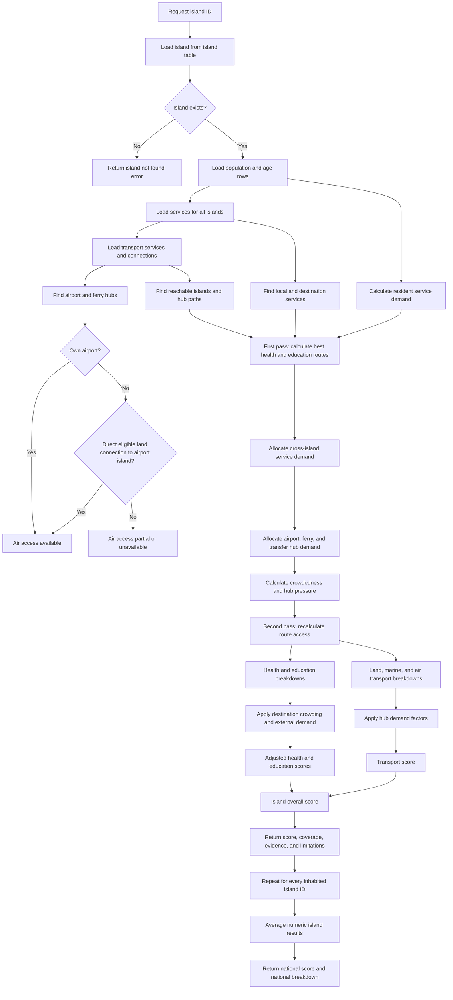

# Island and National Scoring Plan



## Purpose

This document defines the implementation plan for server-side scoring
functions that calculate an island score from an `islandId` and calculate a
national score by querying all inhabited island IDs directly from the database.
The score includes local
services, cross-island service demand, population crowdedness, and demand on
transport hubs such as airports and ferry terminals.

The implementation is based on `old/docs/scor_system.md`, but it is designed
to work with the data currently available in this repository. It must return a
useful partial score when some data is missing instead of returning an empty
result unnecessarily.

## Public Function

The first implementation will expose a server-only function with this shape:

```ts
getIslandScore(islandId: string): Promise<IslandScoreResult>

getNationalScore(): Promise<NationalScoreResult>
```

The function must:

- Validate the island ID.
- Load all scoring inputs from the database.
- Never trust a client-provided score or island name.
- Return a deterministic result for the same database snapshot.
- Return a typed error when the island does not exist.
- Never modify database data.
- Use a two-pass calculation so cross-island demand can affect destination
  services and transport hubs.

The function should be placed under:

```text
src/lib/server/scoring/island-score.ts
```

Pure calculation helpers should not read the database directly. They should
receive typed input objects so that the formulas can be reused for scenario
calculations later.

## Database Inputs

### Island

Table: `island`

Used fields:

- `id`
- `name`
- `islandType`
- `latitude`
- `longitude`
- `geoJson`
- `atollId`

The island record is the required root record. If it does not exist, the
function returns an `ISLAND_NOT_FOUND` error.

### Population

Table: `population`

Used fields:

- `islandId`
- `ageCategory`
- `amount`

Population is used as the denominator wherever a relevant population group is
available. Current seeded categories include `total` and age indicator rows
such as children, working-age residents, and older adults.

If only `total` is available, the result can still be calculated, but the
health and education components must be marked `partial` because exact service
need groups are not available.

### Services

Table: `service`

Used fields:

- `islandId`
- `serviceType`
- `subtype`
- `latitude`
- `longitude`
- `name`

Service types are:

- `health`
- `education`
- `transport`

The subtype must be used to match the service to the calculation. A generic
service must not automatically satisfy every health or education need.

### Transport Connections

Table: `transport_connection`

Used fields:

- `fromIslandId`
- `toIslandId`
- `connectionType`
- `directionality`
- `distanceM`
- `source`
- `sourceObjectId`
- `modeled`

Connection types are:

- `air`
- `ferry`
- `bridge`
- `causeway`
- `land_link`

Only valid land connection types may provide direct land access to another
island. Ferry connections provide marine evidence, not land access. Modeled
`air` links represent airport gateway connectivity and are kept separate from
land and marine demand allocation.

### Transport Routes

Table: `transport_route`

Transport route data is used as supporting evidence for transport coverage and
provenance. It does not by itself prove a scheduled service when `modeled` is
true.

### Land Area and Inhabited Islands

The national function accepts island IDs, but it must verify that each selected
island is inhabited before scoring it. The current seed process maps
`Residential Island` to `islandType = 'inhabited'` and
`Uninhabited Island` to `islandType = 'uninhabited'`.

Crowdedness requires usable land area. The preferred future database field is
`island.landAreaKm2`. Until that field exists, the scorer may calculate an
area estimate from the stored `geoJson` polygon and mark the crowdedness result
as `partial` with `areaSource = 'geojson_estimate'`.

Invalid or non-positive area is unavailable, not zero.

## Score Hierarchy

The score is normalized to `0..100`.

```text
transport score = weighted mean(land, marine, air)

adjusted health = health base × crowding factor × external demand factor
adjusted education = education base × crowding factor × external demand factor

island overall = weighted mean(adjusted health,
                              adjusted education,
                              transport)
```

Starting weights:

```text
health     = 1/3
education  = 1/3
transport  = 1/3

land       = 1/3 of transport
marine     = 1/3 of transport
air        = 1/3 of transport
```

Unavailable components are excluded and the remaining weights are
renormalized. Land, marine, and air must not be counted as additional
top-level domains.

Crowdedness and external demand are impact factors, not extra top-level
domains. This keeps the hierarchy explainable and prevents population pressure
from being counted twice.

## Component Calculations

### Health

1. Find health services assigned to the island.
2. Match service subtypes to available population need groups.
3. Apply configured quality values to recognized service subtypes.
4. Use the best eligible service evidence for each available need group.
5. Aggregate need groups using their available population amounts.
6. Mark the component `partial` when age-specific demand, coordinates, or
   capability evidence is missing.

Health capability rules used by the demand allocator:

- `maternal_child` demand may use a local health centre, clinic, or hospital.
- `chronic_elderly` demand requires a hospital; a health centre or clinic does
  not satisfy elderly care.
- Aggregate transport demand keeps child and elderly health cohorts separate so
  elderly residents without a local hospital generate outbound travel demand.

The initial quality values should be versioned configuration, not hidden
constants:

```text
hospital      = 1.00
health_center = 0.65
clinic        = 0.35
```

The current database does not contain complete capability, travel-time, or
land-network distance data. These limitations must appear in the response.

### Education

1. Find education services assigned to the island.
2. Match the service subtype to the relevant education level.
3. Calculate same-island access when the required level exists locally.
4. If a level is absent locally, look for a supported relocation destination
   only when the required route and relocation evidence exist.
5. Do not treat relocation as a repeated daily commute.
6. Mark missing age groups, education-level classification, or relocation data
   as partial evidence.

The current database can calculate local education availability, but it cannot
fully calculate relocation burden until approved route-time, age, and support
data are available.

### Cross-Island Service Demand

Health and education are not limited to services on the resident's home island.
For every available population need group, the scorer must inspect:

1. Matching services on the home island.
2. Services on islands reachable through eligible land or marine connections.
3. Airport-connected destinations when an approved air route exists.

The best route is selected using the available evidence. A cross-island route
must retain its origin island, destination island, route type, hop count, and
any modeled or missing travel-time evidence.

Examples:

- Elderly residents without suitable chronic care locally may use a reachable
  hospital on another island.
- Students may use a higher education institution on another island through a
  relocation route, not an assumed daily commute.

The first pass identifies the best destinations and estimates the population
demand sent to each destination. The second pass applies destination
crowding and external demand pressure to those routes.

### Crowdedness

Crowdedness is measured from the island population and usable land area:

```text
population_density = total_population / land_area_km2
crowding_pressure = min(1, population_density / density_reference)
crowdedness_score = 100 × (1 - crowding_pressure)
```

The result must return both `population_density` and `crowdedness_score`.

Crowding affects service access once per destination:

```text
health_crowding_factor = max(
  minimum_crowding_factor,
  1 - health_crowding_impact × crowding_pressure
)

education_crowding_factor = max(
  minimum_crowding_factor,
  1 - education_crowding_impact × crowding_pressure
)
```

For a local service, the home island is the destination. For a cross-island
route, only the service destination's factor is applied. Crowding must not be
applied once to the origin, again to the destination, and then a third time to
the overall score.

Starting configuration values are density reference `5,000 people/km2`, health
impact `0.20`, education impact `0.25`, and minimum factor `0.40`. These values
must be versioned configuration.

### External Service Demand

External demand is the demand arriving from other islands for a destination's
health or education services.

Service demand must also include the destination island's own age-based demand.
The local demand mapping is versioned configuration. For the current population
artifact, hospital emergency demand uses children plus elderly residents because
there is no baby-specific population row. Education demand uses children,
adolescents, and youth for the corresponding education levels.

Aggregate health and education demand must count each configured age cohort once.
The aggregate health load is children plus elderly residents. The aggregate
education load is children plus adolescents plus youth. Preschool and primary
education both use the child cohort, and secondary and higher-secondary
education both use the adolescent cohort, so those service rows must not be
added together again. The detailed per-service rows remain available for route
and access scoring.

```text
aggregate_health_demand = children + elderly
aggregate_education_demand = children + adolescents + youth
```

```text
local_service_demand(destination) =
  sum(configured age-group population for the service)

service_demand(destination) =
  local_service_demand(destination)
  + inbound_service_demand(destination)

service_demand_percent = min(
  100,
  100 × service_demand / max(1, destination_resident_population)
)
```

```text
external_demand(destination) =
  sum(population_need routed to destination from other islands)

external_demand_pressure =
  external_demand / max(1, destination_resident_population)

service_demand_pressure =
  service_demand / max(1, destination_resident_population)

external_demand_factor = max(
  minimum_external_demand_factor,
  1 - external_demand_impact × service_demand_pressure
)
```

The external demand factor is applied to destination health or education route
access using combined local and inbound pressure. Inbound-only pressure remains
available as a diagnostic value. The percentage shown in analytics is capped at
100%, but raw demand values are retained.

Inbound demand uses the same unique-cohort rule. A source island contributes its
children, elderly, adolescents, and youth cohorts once to the selected demand
destination; repeated service rows do not create repeated inbound population.

Outbound demand is retained at the origin:

```text
outbound_service_demand(origin) =
  sum(origin population need without a suitable local service)

outbound_demand_percent = min(
  100,
  100 × outbound_service_demand / max(1, origin_resident_population)
)
```

Outbound demand represents the need to leave the origin, even when no eligible
connection or destination is available. A missing external route also marks the
need `unserved`; it must not erase the outbound demand signal. A second standalone
outbound penalty must not be applied because it would count the same route burden
twice.

The first implementation should use this as a clearly labelled demand proxy
because the current database has no service capacity table. Once capacity is
available, the preferred calculation is:

```text
capacity_pressure = external_and_local_demand / validated_service_capacity
```

### Transport Hub Demand

Airports, ferry terminals, and land gateways are demand hubs. They may be
used by residents of the local island and by residents travelling from other
islands. Hub presence alone is therefore not a complete transport score.

Transport demand uses the configured working-age, student, and elderly
population cohorts. Each source cohort is allocated once across the stops and
routes that serve it. If an island reaches several stops, its cohort demand is
split across those stops rather than copied into every stop. RTL bus route-stop
membership identifies which connected islands contribute to each stop.

For a stop:

```text
stop_demand =
  local_cohort_demand
  + connected_island_cohort_demand
  + health_and_education_transfer_demand
```

Missing local care adds demand to the relevant marine or air departure and
arrival hubs. The same transfer is not copied to unrelated stops.

```text
stop_load_ratio = stop_demand / estimated_stop_capacity
stop_score = 100 × max(
  minimum_transport_stop_factor,
  1 - transport_demand_impact × stop_load_ratio
)

island_average_transport_load = average(stop_load_ratio)
island_transport_score = average(stop_score)
```

The island transport score continues to combine land, marine, and air scores,
but each mode score now comes from the average of its stop scores. Stop
capacity is a configured proxy because measured passenger capacity is not
available, so the result remains `partial`.

For each hub:

```text
hub_demand =
  local_resident_transport_demand
  + cross_island_health_demand
  + cross_island_education_demand
  + transfer_demand
```

The pressure and penalty are:

```text
hub_pressure = hub_demand / validated_hub_capacity

hub_access_factor = max(
  minimum_hub_factor,
  1 - hub_demand_impact × hub_pressure
)
```

When capacity is missing, the scorer may use a configured demand proxy, but it
must mark the hub and affected transport component `partial` and explain that
measured capacity is unavailable.

Hub factors affect transport routes as follows:

```text
route_access =
  connectivity_factor
  × hop_factor
  × travel_time_factor
  × origin_hub_factor
  × destination_hub_factor
```

Each hub occurrence is penalized once. The same hub must not be multiplied into
the route more than once because it appears in multiple data records.

Transport breakdowns must show hub impact separately for:

- Land gateways.
- Ferry terminals.
- Airports.
- Transfer hubs.

### Land Transport

Land access is based on:

- Transport services classified as land or bus access.
- `bridge`, `causeway`, and `land_link` connections.
- Valid local geometry where available.

The current database does not contain a complete local road graph or walking
distances. Therefore, a land score based only on service or connection
presence is `partial` unless complete distance evidence is later added.

### Marine Transport

Marine access is based on:

- Ferry transport services.
- Eligible `ferry` connections.
- Route evidence and its `modeled` status.

Modeled ferry connectivity may contribute to the marine subscore, but it must
be labelled as modeled. It cannot prove an official schedule or produce a
complete health or education route score without approved travel-time data.

### Air Transport and Airport Inheritance

An island has airport access when either condition is true:

1. The island has an airport service itself.
2. The island has a direct eligible land connection to an island with an
   airport service.

Eligible direct land connections are:

- `bridge`
- `causeway`
- `land_link`

Ferry and air connections do not count as direct land connections.

For the first implementation, airport inheritance is one hop only. A chain of
multiple land-connected islands should not inherit airport access until graph
traversal and hop penalties are implemented.

Airport inheritance contributes to the air transport subscore only. It does
not automatically prove that a hospital or education facility is reachable on
the airport island. Those routes require approved cross-island service and
travel-time evidence.

The result must preserve the source of airport access:

```ts
type AirportAccess = {
  available: boolean;
  source: 'own_airport' | 'direct_land_connection' | 'unavailable';
  airportIslandId: string | null;
};
```

## Partial Score Rules

The calculator must return the best defensible number supported by the data.

```text
numeric       complete evidence supports the component
partial       some evidence supports a score, but important inputs are missing
unavailable   no meaningful numeric calculation is possible
zero          complete evidence confirms no access
```

`zero` is a numeric score of `0`, not an unavailable value.

Recommended behavior:

- If at least one domain has usable evidence, return an island score.
- If one domain is unavailable, calculate the score from available domains and
  mark the island result `partial`.
- If all domains are unavailable, return `score: null` and
  `status: 'unavailable'`.
- Never silently convert missing evidence into zero.
- Always return coverage and limitations with a partial score.

When the validated island snapshot has population and service/transport
inventory coverage, but no matching service or route is found for a need, that
need contributes numeric `0` with `status: 'partial'`. This represents no
eligible access in the current evidence while preserving the limitation that
the evidence may be incomplete. A component is `unavailable` only when its
denominator or required evidence cannot support any defensible calculation.

The island scorer runs in two passes:

1. Calculate local and cross-island service routes without demand penalties.
2. Allocate service demand and transport hub demand, calculate pressure, and
   recalculate affected health, education, and transport routes.

Coverage is the proportion of the validated denominator represented by numeric
evidence. The implementation should expose the configured coverage threshold,
but a score may still be returned below that threshold as `partial`. Scores
below the approved threshold must not be treated as fully reliable official
rankings.

## Result Contract

```ts
type ScoreStatus = 'numeric' | 'partial' | 'unavailable';

type ScoreComponent = {
  baseScore: number | null;
  score: number | null; // adjusted score used by parent aggregation
  adjustmentFactor: number | null;
  status: ScoreStatus;
  coverageRatio: number;
  denominatorPopulation: number | null;
  numericPopulation: number | null;
  evidenceCount: number;
  limitations: string[];
};

type IslandScoreResult = {
  islandId: string;
  islandName: string;
  score: number | null;
  status: ScoreStatus;
  coverageRatio: number;
  health: ScoreComponent;
  education: ScoreComponent;
  transport: ScoreComponent & {
    land: ScoreComponent;
    marine: ScoreComponent;
    air: ScoreComponent;
    hubImpacts: HubDemandImpact[];
    demand: TransportDemandResult;
  };
  crowdedness: CrowdednessResult;
  demand: DemandSummary;
  externalDemand: ExternalDemandResult;
  airportAccess: AirportAccess;
  limitations: string[];
  assumptions: string[];
  evidence: {
    populationRows: number;
    healthServices: number;
    educationServices: number;
    transportServices: number;
    transportConnections: number;
  };
};

type CrowdednessResult = {
  score: number | null;
  populationDensity: number | null;
  population: number | null;
  landAreaKm2: number | null;
  areaSource: 'database' | 'geojson_estimate' | 'unavailable';
  pressure: number | null;
  healthFactor: number | null;
  educationFactor: number | null;
  status: ScoreStatus;
};

type ExternalDemandResult = {
  inboundHealthDemand: number | null;
  inboundEducationDemand: number | null;
  localHealthDemand: number | null;
  localEducationDemand: number | null;
  outboundHealthDemand: number | null;
  outboundEducationDemand: number | null;
  healthPressure: number | null;
  educationPressure: number | null;
  inboundHealthPressure: number | null;
  inboundEducationPressure: number | null;
  healthFactor: number | null;
  educationFactor: number | null;
  status: ScoreStatus;
  limitations: string[];
};

type DemandMetric = {
  local: number;
  inbound: number;
  outbound: number;
  unserved: number;
  combined: number;
  demandPercent: number | null;
  outboundPercent: number | null;
};

type InboundDemandSource = {
  originIslandId: string;
  health: number;
  education: number;
  total: number;
};

type DemandSummary = {
  population: number | null;
  health: DemandMetric;
  education: DemandMetric;
  healthCareDemand: {
    children: DemandMetric | null;
    elderly: DemandMetric | null;
  };
  healthByNeed: Record<string, DemandMetric>;
  educationByNeed: Record<string, DemandMetric>;
  inboundSources: InboundDemandSource[];
};

type TransportDemandStop = {
  stopId: string;
  stopName: string | null;
  mode: 'land' | 'marine' | 'air';
  connectedIslandIds: string[];
  localDemand: number;
  connectedDemand: number;
  workingDemand: number;
  studentDemand: number;
  elderlyDemand: number;
  careTransferDemand: number;
  totalDemand: number;
  capacity: number;
  loadRatio: number;
  score: number;
};

type TransportDemandResult = {
  workingDemand: number;
  studentDemand: number;
  elderlyDemand: number;
  careTransferDemand: number;
  totalDemand: number;
  averageLoad: number | null;
  score: number | null;
  modes: {
    land: {
      stopCount: number;
      totalDemand: number;
      careTransferDemand: number;
      averageLoad: number | null;
      score: number | null;
    };
    marine: {
      stopCount: number;
      totalDemand: number;
      careTransferDemand: number;
      averageLoad: number | null;
      score: number | null;
    };
    air: {
      stopCount: number;
      totalDemand: number;
      careTransferDemand: number;
      averageLoad: number | null;
      score: number | null;
    };
  };
  stops: TransportDemandStop[];
};

type HubDemandImpact = {
  hubId: string;
  hubType: 'airport' | 'ferry_terminal' | 'land_gateway' | 'transfer';
  localDemand: number | null;
  incomingDemand: number | null;
  outboundDemand: number | null;
  transferDemand: number | null;
  totalDemand: number | null;
  capacity: number | null;
  pressure: number | null;
  factor: number | null;
  scoreImpact: number | null;
  status: ScoreStatus;
  limitation: string | null;
};

type NationalScoreResult = {
  score: number | null;
  status: ScoreStatus;
  health: ScoreComponent;
  education: ScoreComponent;
  transport: ScoreComponent & {
    land: ScoreComponent;
    marine: ScoreComponent;
    air: ScoreComponent;
  };
  crowdedness: ScoreComponent;
  demand: DemandSummary;
  externalDemand: ScoreComponent;
  islandCount: number;
  scoredIslandCount: number;
  partialIslandCount: number;
  unavailableIslandCount: number;
  scores: IslandScoreResult[];
  limitations: string[];
};
```

## National Score

The national calculator will:

1. Query the `island` table directly.
2. Select only islands with `islandType = 'inhabited'`.
3. Extract the IDs from those database records.
4. Calculate one result per inhabited island by calling `getIslandScore()`.
5. Average all numeric island results using an arithmetic mean.
6. Average the health, education, transport, land, marine, and air breakdowns
   from the corresponding numeric island components.
7. Include partial island results while preserving their status and coverage.
8. Exclude unavailable island results from numeric averages, but report them.
9. Return queried, inhabited, scored, partial, and unavailable island counts,
   coverage, and all
   limitations.

The national score must not hide missing data by averaging only the best
islands. A partial national score must clearly state how many queried, inhabited,
scored, partial, and unavailable islands were included.

National demand must be calculated from all queried inhabited islands before
the final island scores are averaged. This ensures that cross-island health,
education, airport, ferry, and transfer demand can affect the destination
islands consistently.

## Planned Modules

```text
src/lib/server/scoring/
├── types.ts             # Score result and input contracts
├── config.ts            # Versioned weights and factor configuration
├── database-input.ts    # Drizzle queries for island, population, services, and routes
├── factors.ts           # Pure quality and evidence calculations
├── demand-allocation.ts  # Cross-island health, education, and hub demand
├── hub-pressure.ts       # Airport, ferry, land, and transfer pressure
├── island-score.ts      # getIslandScore(islandId)
├── national-score.ts    # getNationalScore()
└── index.ts             # Server-only public exports
```

Queries belong in the database input module. Formula calculations belong in
pure functions. The scorer must not read HTTP requests, environment variables,
live provider data, or UI state.

## Implementation Sequence

1. Add score types and versioned configuration.
2. Add Drizzle queries for island, population, services, routes, and
   connections.
3. Add inhabited-island filtering for the national function.
4. Implement airport detection and one-hop direct land inheritance.
5. Implement first-pass local and cross-island health and education routes.
6. Implement cross-island demand allocation.
7. Implement population density and crowdedness factors.
8. Implement airport, ferry-terminal, land-gateway, and transfer hub demand.
9. Implement second-pass route recalculation with service and hub pressure.
10. Implement land, marine, and air transport breakdowns.
11. Implement adjusted health, education, transport, and overall aggregation.
12. Implement database-driven arithmetic national aggregation by calling
    `getIslandScore()` for every inhabited island.
13. Add score explanations, evidence counts, coverage, demand impacts, and
    limitations.
14. Integrate the scoring functions into the mobility facade or API endpoint.
15. Add tests for valid IDs, unknown IDs, uninhabited IDs, missing data, partial
    scores, airport inheritance, cross-island demand, hub pressure, modeled
    ferries, and deterministic repeated calculations.

## Current Limitations and Future Data

The full policy scoring model will require additional database or artifact
fields for:

- Usable land area.
- Airport, ferry-terminal, land-gateway, and transfer-hub capacity.
- Exact age boundaries and service demand mappings.
- Facility capability and review status.
- Local land-network paths and distances.
- Approved marine and air travel times.
- Hop, transfer, and relocation factors.
- Destination crowding.
- External service demand allocations.
- Capacity and as-of snapshots.
- Complete provenance and scoring configuration lineage.

Until those fields are available, the calculator must expose partial results
with explicit limitations rather than pretending the data is complete.
